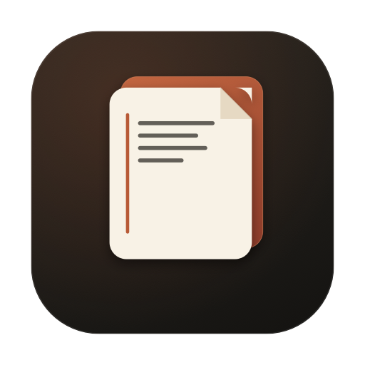
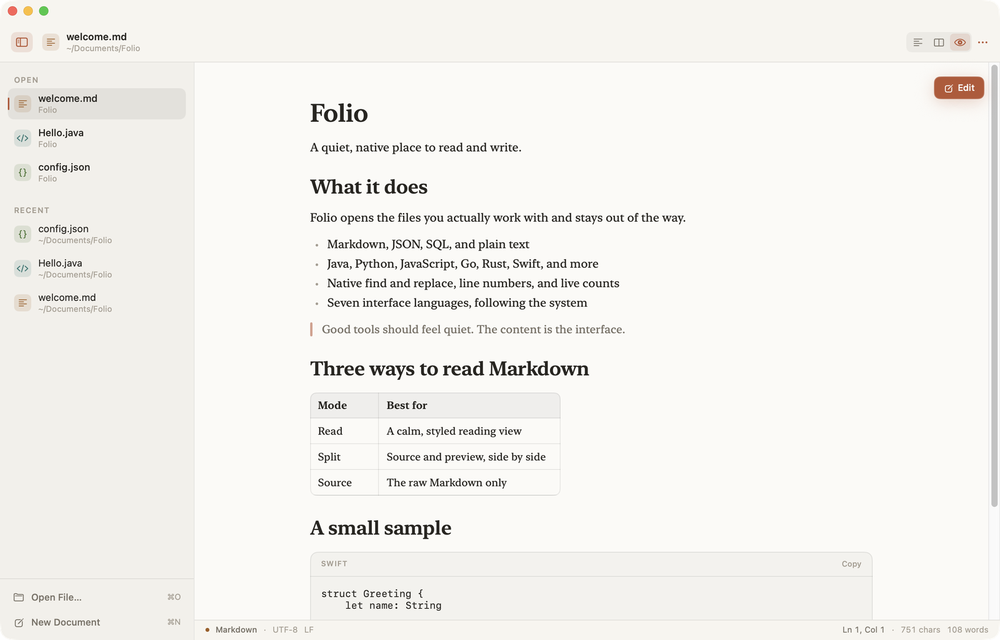
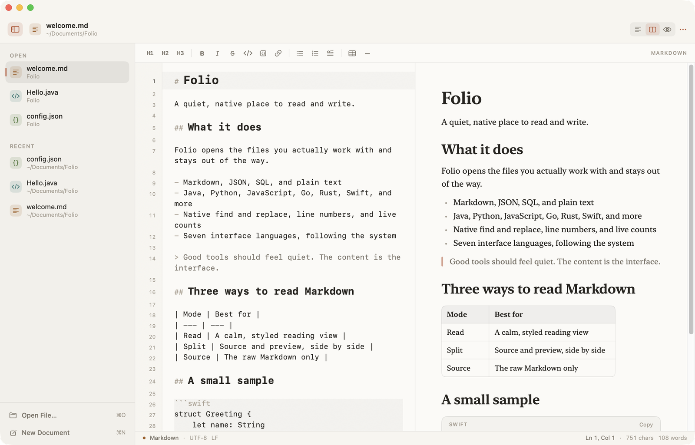
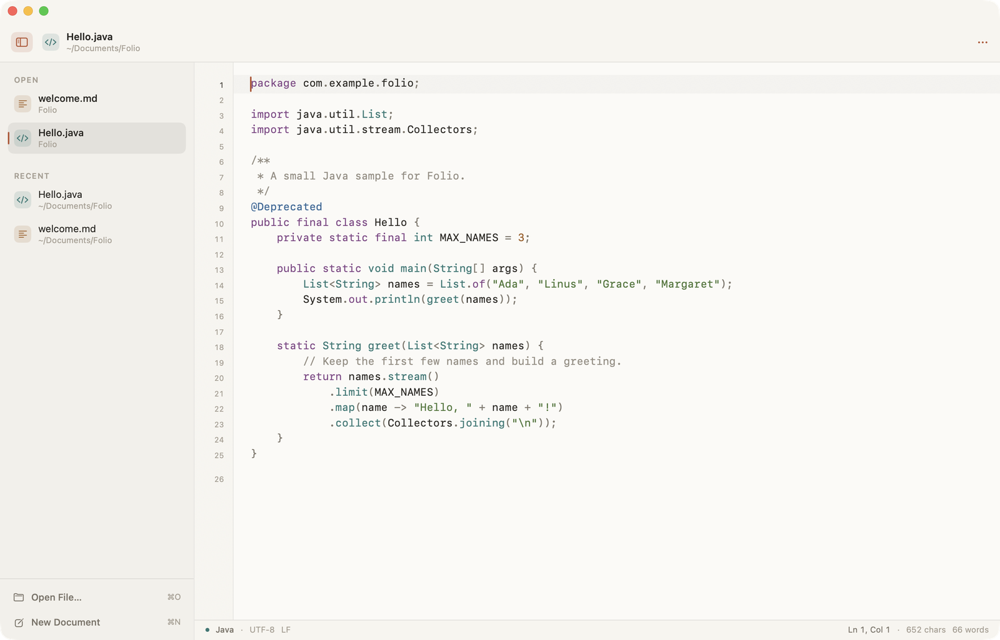
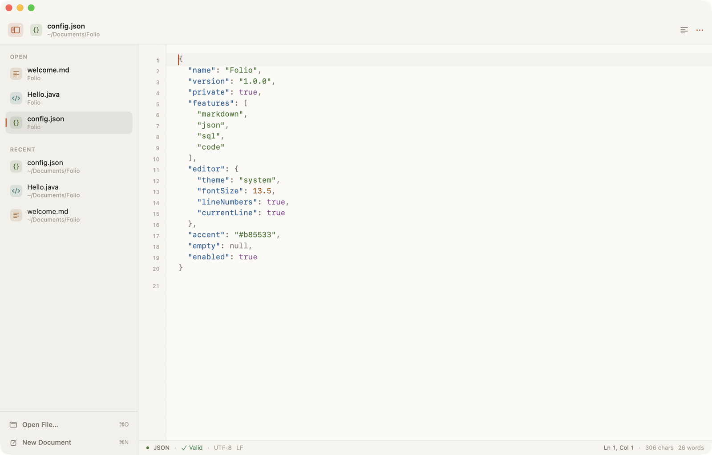

<div align="center">
  
  <h1>Folio</h1>
  <p><strong>一款安静、原生的 macOS 文本编辑器，支持 Markdown、JSON、SQL 与代码。</strong></p>
  <p>
    
    
    
    
    <a href="https://github.com/BugCooker-cooking/folio/releases/latest"></a>
  </p>
  <p>
    <a href="#功能">功能</a> ·
    <a href="#支持的文件">支持的文件</a> ·
    <a href="#下载">下载</a> ·
    <a href="#构建与运行">构建</a> ·
    <a href="#快捷键">快捷键</a> ·
    <a href="README.md">English</a>
  </p>
</div>



Folio 是一款轻量的原生 macOS 编辑器，专注于你真正会打开的文件。Markdown 默认以带样式的阅读模式呈现，代码文件自动识别语言并高亮，JSON 与 SQL 则提供恰到好处的小工具。它不是 IDE，这正是它的价值。

应用使用 SwiftUI 与 AppKit 构建，无第三方依赖，界面支持七种语言，整个 App 保持单窗口、克制而安静。

## 为什么是 Folio

大多数编辑器要么是浏览器里的文本框，要么是带项目树、终端和语言服务器的完整 IDE。Folio 位于两者之间：打开得足够快，知道不同类型的文件应该长什么样，又保留原生的文本编辑体验。

- **阅读优先。** Markdown 打开就是排版好的阅读视图，点击「编辑」进入源码与预览的分栏。
- **原生体验。** 撤销、查找、文件面板、菜单与键盘行为都来自 AppKit。
- **刻意轻量。** 不内置 Web 编辑器，不引入第三方框架，没有账户与遥测。

## 功能

### 阅读与编辑

- 支持 Markdown、JSON、SQL、纯文本和常见代码文件
- 原生 `NSTextView` 编辑，支持撤销与重做
- 查找替换，支持区分大小写与正则表达式
- 选中文本后，全文档相同内容自动高亮
- 行号、当前行高亮、光标行列、字符数与词数统计
- 自动识别 UTF-8/UTF-16/Latin-1，保存时保留原编码、BOM 与换行符
- 拖拽打开、最近文件、侧栏管理打开的文档
- 浅色、深色与跟随系统主题，可调字号
- 所有纯图标按钮都有本地化的悬停提示

### Markdown

- 默认进入**带样式的阅读模式**
- 点击浮动的**编辑**按钮进入左右分屏：左侧源码，右侧实时预览
- 顶栏支持**源码 / 分栏 / 预览**三种模式
- `⇧⌘P` 按「预览 → 分栏 → 源码」循环
- 格式工具栏：标题、粗体、斜体、删除线、行内代码、代码块、链接、列表、引用、表格、分隔线
- 预览支持标题、强调、列表、引用、代码块、链接、表格与分隔线

### JSON

- 键、字符串、数字、布尔值、`null` 与标点使用不同颜色
- 状态栏实时显示 JSON 是否有效
- 支持格式化与压缩，且不会改变原有键顺序
- 明确拒绝尾随逗号

### SQL 与代码

- SQL 关键字、类型、字符串、注释、数字与操作符高亮
- 对 Java、Kotlin、Scala、Python、JavaScript/TypeScript、C/C++、C#、Go、Rust、Ruby、PHP、Swift、Shell、HTML/XML/SVG、CSS/SCSS/LESS、YAML、TOML 提供轻量词法高亮
- 注解、属性、变量、函数调用、HTML 标签与配置键按语言进行着色
- 状态栏显示识别到的语言

### 原生 macOS 细节

- 七种界面语言：简体中文、繁体中文、日语、韩语、英语、法语、德语；默认跟随系统
- 使用系统打开/保存面板与未保存变更提示
- 原生快捷键、菜单命令与拖拽
- 克制的暖纸色视觉系统，自适应浅色与深色模式

## 截图

| Markdown 分栏编辑 | Java |
| --- | --- |
|  |  |



## 支持的文件

| 类型 | 扩展名 | 行为 |
| --- | --- | --- |
| Markdown | `.md`, `.markdown`, `.mdown`, `.mkd`, `.mmd` | 阅读模式、分栏编辑、格式工具栏 |
| JSON | `.json`, `.geojson` | 类型着色、校验、格式化、压缩 |
| SQL | `.sql`, `.psql` | 关键字、类型、字符串、注释与操作符高亮 |
| 源代码 | Java、Kotlin、Scala、Python、JavaScript/TypeScript、C/C++、C#、Go、Rust、Ruby、PHP、Swift、Shell、HTML/XML、CSS、YAML、TOML | 语言识别与词法高亮 |
| 纯文本 | 其他文本文件 | 原生编辑、查找、行号与统计 |

代码扩展名包括 `.java`、`.kt`、`.scala`、`.py`、`.js`、`.jsx`、`.ts`、`.tsx`、`.c`、`.cpp`、`.cs`、`.go`、`.rs`、`.rb`、`.php`、`.swift`、`.sh`、`.html`、`.xml`、`.css`、`.yaml`、`.toml` 等。

文件会进行 UTF-8/UTF-16/Latin-1 检测；保存时保留原编码、BOM 与换行符。二进制文件和超过 24 MB 的文件会被拒绝。

`Examples/` 目录包含几个可以直接打开体验的文件。

## 下载

适用于 Apple Silicon 与 Intel 的预构建**通用版**：**[最新版本](https://github.com/BugCooker-cooking/folio/releases/latest)**。

1. 下载 `Folio-1.0.0-macOS-universal.zip`。
2. 解压后把 `Folio.app` 移动到「应用程序」。
3. 构建使用 ad-hoc 签名，尚未公证。若首次打开被系统拦截，请按住 Control 点击应用并选择「打开」。

## 构建与运行

环境：**macOS 14 或更高版本**、**Xcode 16 或更高版本**（Swift 5.9+）。

```sh
./Scripts/build.sh release
open .build/Folio.app
```

调试构建：

```sh
./Scripts/build.sh debug
open .build/Folio.app
```

App 会生成在 `.build/Folio.app`，并使用本地 ad-hoc 签名。构建脚本会复制图标与文档类型信息；需要完整 `.app` 时请使用脚本。

在 Xcode 中开发：

```sh
open Package.swift
```

`Folio` scheme 可以运行 SwiftUI App；需要带图标和 Finder 文档类型的完整包时，仍使用构建脚本。

## 使用说明

- **Markdown：** 打开 `.md` 文件即进入阅读视图。点击浮动「编辑」或按 `⇧⌘P` 进入分栏；顶栏可切换源码、分栏、预览。
- **JSON：** 使用工具栏格式化按钮或 `⇧⌘F`；`⇧⌘M` 压缩。状态栏会显示校验结果。
- **代码：** 打开支持的文件即可；后缀决定语言，状态栏显示语言名称。
- **查找：** `⌘F` 打开查找栏，`⌘G` / `⇧⌘G` 切换匹配项，支持正则。
- **设置：** `⌘,` 打开外观、行号、当前行高亮、选中匹配高亮与字号。
- **关闭/退出：** 有未保存修改时会先询问。

## 快捷键

| 快捷键 | 操作 |
| --- | --- |
| `⌘N` | 新建文档 |
| `⌘O` | 打开文件 |
| `⌘S` | 保存 |
| `⇧⌘S` | 另存为 |
| `⌘W` | 关闭文档 |
| `⌘F` | 查找与替换 |
| `⌘G` / `⇧⌘G` | 下一个 / 上一个匹配 |
| `⌘L` | 跳转到行 |
| `⇧⌘P` | 切换 Markdown 布局 |
| `⌃⌘S` | 显示 / 隐藏侧栏 |
| `⌘=` / `⌘-` / `⌘0` | 放大 / 缩小 / 实际大小 |
| `⌘,` | 设置 |

## 架构

Folio 是一个无第三方依赖的 Swift Package Manager 可执行项目：

```
Sources/Folio/
  App/        应用入口、菜单、设置、本地化
  Model/      文档、文件 IO、语言识别、JSON 工具、最近文件
  Editor/     NSTextView 桥接、语法引擎、Markdown 操作、行号、查找
  Views/      侧栏、顶栏、欢迎页、预览、查找栏、状态栏、悬停提示
Examples/     可直接打开的示例文件
Scripts/      构建脚本与代码绘制的 App 图标
docs/         README 资源
```

编辑器主体是一个包裹在 SwiftUI 里的 `NSTextView`。语法标记在后台线程生成，在输入安静下来后应用，因此无需引入高亮框架也能保持轻快。Markdown 预览使用 SwiftUI；所有界面文案以小型内置语言表保存，App 保持自包含。

## 范围

Folio 刻意是一款专注的编辑器，而不是 IDE：

- 语法高亮是词法级的，不提供 LSP、补全、诊断、终端或项目树。
- Markdown 预览覆盖常用语法；嵌入 HTML 与 MDX 按源码显示。
- 单窗口，打开的文档放在侧栏，没有标签页或多窗口。
- 显式保存，没有自动保存。

符合同样气质的方向：代码折叠、分栏比例记忆、更多语言、可选自动保存、主题定制。

## 贡献

欢迎提交 [Issue](https://github.com/BugCooker-cooking/folio/issues) 与 [Pull Request](https://github.com/BugCooker-cooking/folio/pulls)。请尽量保持应用轻量、原生：

- 提交 PR 前运行 `./Scripts/build.sh release`。
- 除非收益非常明确，否则不要引入第三方依赖。
- 测试受影响的文件类型，以及浅色与深色外观。
- PR 中描述手动验证步骤；目前还没有自动化测试套件。

## 许可证

MIT，详见 [LICENSE](LICENSE)。版本历史见 [CHANGELOG.md](CHANGELOG.md)。
